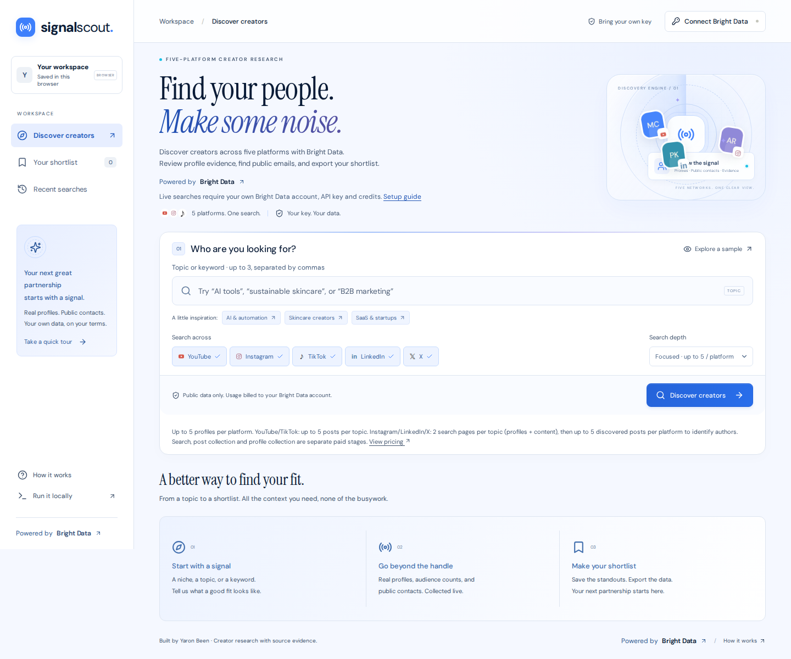

# Signal Scout

**Find your people. Make some noise.**

Discover creators across **YouTube, Instagram, TikTok, LinkedIn, and X**, collect real profile data and public contact emails with Bright Data, and build your next partnership shortlist.

**[Open the app](https://signal-scout.yaron-been.workers.dev)** · **[How it works](#how-it-works)** · **[Run locally](#one-line-setup-for-your-coding-agent)**



## For marketers

1. Open the app and click **Connect Bright Data**.
2. Paste your own Bright Data API key.
3. Enter 1–3 topics or keywords separated by commas.
4. Choose platforms and click **Discover creators**.
5. Inspect the evidence, save the good fits, and export a CSV.

No Signal Scout account. No separate AI key. Your Bright Data account pays for data collection; the app itself is open source.

You can explore the interface without a key using **Explore a sample**. Sample creators and metrics are fictional and explicitly labeled.

### What your Bright Data account needs

- An API key with **Web Scraper API** access and available credits.
- An active, working **SERP API zone** for Instagram, LinkedIn, and X discovery. Create one at [Bright Data → Create an API](https://brightdata.com/cp/web_access/new). The app lists your active search zones. With multiple zones, you must choose one explicitly; it never silently selects the first. Active status does not guarantee successful search-engine access.
- Optional: an active **Web Unlocker API** to scan a creator's linked website for public email. This is a separate, user-triggered request.

[Find your API key](https://brightdata.com/cp/setting/users) · [SERP setup guide](https://docs.brightdata.com/scraping-automation/serp-api/quickstart)

If one product is unavailable, other platforms can still complete. Missing emails and metrics stay clearly marked.

## One-line setup for your coding agent

Paste this into **Claude Code, OpenCode, or Cursor**:

```text
Clone https://github.com/yaronbeen/signal-scout and read AGENTS.md. Check Git and Node.js 22+; explain or install missing prerequisites with my permission. Run npm ci and npm run check, start npm run dev as a persistent process, verify http://localhost:8787/api/health has ok: true, and open http://localhost:8787. Then give me the human setup steps: create a Bright Data account with available credits and Web Scraper API access, enable a SERP API zone for Instagram/LinkedIn/X, optionally enable Web Unlocker for website email scans, enter my key only in the app, and select a working search zone. Explain that connecting checks account metadata, not whether every paid service works. Keep the server running; after refresh I reconnect my key and resume existing jobs. Do not request my key in chat, store it, configure a hosted key, or submit paid test searches without asking me. No Cloudflare login is needed locally.
```

The agent handles setup; you enter your API key in the browser. Never paste the key into the agent prompt.

### Your steps after the agent finishes

1. Complete the [Bright Data account checklist](#what-your-bright-data-account-needs): credits, Web Scraper API access, and a working SERP API zone. Web Unlocker is optional.
2. Open http://localhost:8787 and click **Connect Bright Data**. Enter your key only in the app.
3. Choose your search zone for Instagram, LinkedIn, and X, then choose topics/platforms and depth. Connecting checks account metadata, not product permissions, balance, or search-zone health.
4. Keep the local server running. After a refresh, reconnect your key and resume existing jobs.

### Visiting the live website

No installation is required. Every visitor supplies their own key and pays for their own Bright Data usage. The tab keeps the key in memory and sends it over HTTPS through the website’s stateless relay to Bright Data. The application does not save it or provide a shared owner key. Refreshing or closing the tab clears the key; reconnect to resume saved jobs. Sample mode needs no key.

### Manual local setup

Install [Node.js 22 or newer](https://nodejs.org/) and [Git](https://git-scm.com/downloads), then:

```bash
git clone https://github.com/yaronbeen/signal-scout.git
cd signal-scout
npm ci
npm run check
npm run dev
```

Open **http://localhost:8787**. Works on Windows, macOS, and Linux. No Docker, Python, database, or environment file required.

Keep the terminal/server running while using the app. Connect your Bright Data key in the browser and choose a working search zone for Instagram, LinkedIn, and X. A Cloudflare account/login is only needed to deploy publicly. Sample mode needs no key; live collection requires provider access and available credits. After a refresh, reconnect your key to resume the saved snapshot jobs.

## What you get

- Five-platform discovery with independent progress.
- Names, bios, public audience counts, profile links, and websites.
- Public emails with the URL they came from.
- Keyword-match evidence explaining why a creator surfaced.
- Per-platform filters, name/bio search, audience filtering, and email filtering.
- Browser-saved shortlists and recent briefs.
- CSV export with contacts, provenance, and collection dates.
- Pause/resume for upstream snapshot jobs, without restarting collection.
- Responsive interface with Bright Data-inspired colors, an animated discovery radar, reduced-motion support, and self-hosted fonts.

### Data quality

Public email discovery is not mailbox verification. Some creators publish no email. Keyword matches are research signals, not a prediction of audience fit or campaign performance. Follower counts are platform-specific; they are not unique reach across platforms. Review source evidence before choosing a partner.

Search depth controls how many candidates per platform are enriched. YouTube/TikTok content discovery is capped per keyword. Instagram/LinkedIn/X read two search pages per keyword (profiles and content), collect up to the selected depth of discovered posts per platform, then enrich up to that depth of profiles. Search, post collection, and profile collection are separate paid stages. Depth is a ceiling, not a promise of that many results.

## How it works

The React frontend talks to a small same-origin Cloudflare Worker. The Worker validates requests and forwards **your key** to Bright Data. Scraping stays with Bright Data.

- **YouTube:** discover videos by keyword → deduplicate channels → collect channel profiles.
- **TikTok:** discover posts by keyword → deduplicate creators → collect profiles.
- **Instagram, LinkedIn, X:** Bright Data SERP profile/content searches → dedicated post collectors identify matching authors → deduplicate and prioritize authors with matching posts → platform-specific profile scrapers.
- **Optional contact scan:** explicitly fetch a linked public website through Bright Data Web Unlocker → extract visible public email.

Long-running scrapers return snapshot IDs. The browser polls short status requests rather than holding open a server connection. Successful platforms keep their results even if another platform fails.

### Discovery and platform filters

YouTube and TikTok use keyword content searches, then collect the channels/creators behind those results. Instagram, LinkedIn, and X search Google-indexed profiles and posts through the visitor's SERP zone without requiring “creator” in the query. Dedicated platform post collectors read discovered posts and identify the returned authors; LinkedIn company authors and explicit reposts are excluded from content-author discovery. X discovery uses Google's legacy `twitter.com` index and normalizes identities to `x.com`. Google indexing and bounded samples can miss relevant people. There is no dedicated hashtag discovery mode or exhaustive scan of a creator's content.

Every word of a topic must appear as a whole word in one name, bio, or evidence item; order need not be exact. Collected matching posts rank above profile-topic and search-only matches, with post dates used to break otherwise equal scores. Cards and CSV distinguish matching posts, profile matches, and search-only evidence. Source links and available post dates appear in creator details. Google snippets are not proof of a profile bio match, and post evidence is not an audience-quality score.

Results share one shortlist/export workflow, with platform tabs and counts. Audience filters say subscribers for YouTube, followers for individual other platforms, and followers/subscribers for the combined list. They are reported counts, not equivalent unique reach across networks.

### Key and storage behavior

- The key is kept **in memory for the current tab** and sent only in Authorization headers to the app's API and Bright Data.
- No server database, hosted owner key, or API-key browser persistence.
- Shortlists and recent briefs use local browser storage.
- Current results and pending job references use session storage; reconnect your key after refresh to resume.
- Browser-local research can include public contact information. Use CSV export to retain it elsewhere.
- Pausing stops local polling. Already submitted Bright Data jobs may continue and be billed. Discarding a job reference does not cancel the upstream job.
- A lost search response is never replayed automatically. Check Bright Data usage before explicitly authorizing another paid search. Unresolved job references remain until you discard or reconcile them.

## Deploy to Cloudflare

The app uses Cloudflare Workers with static assets and is designed for the Workers free tier. Bright Data usage and any hosting above free-tier limits are separate.

```bash
npm ci
npx wrangler login
npm run deploy
```

Your API key is **not** a deployment secret. Each visitor connects their own key. The same code serves the hosted app and local version.

Change `name` in `wrangler.jsonc` to deploy under another name. See [deployment notes](docs/DEPLOYMENT.md).

## Development and testing

```bash
npm run check                # unit/integration tests, typecheck, production build
npx playwright install chromium
npm run test:e2e             # desktop and mobile user flows
```

For fast frontend iteration, run `npm run dev` in one terminal and `npm run dev:ui` in another. Vite proxies `/api` to the local Worker.

Tests cover bounded inputs, URL identity, email provenance, unknown metrics, API errors, credential handling, spreadsheet-safe CSV, partial platform failure, shortlists, filters, and responsive flows. Live verification is documented in [docs/VERIFICATION.md](docs/VERIFICATION.md).

## Repository consolidation

This app was informed by these existing projects:

- [bright-data-youtube-outreach](https://github.com/yaronbeen/bright-data-youtube-outreach)
- [bright-data-instagram-outreach](https://github.com/yaronbeen/bright-data-instagram-outreach)
- [bright-data-tiktok-outreach](https://github.com/yaronbeen/bright-data-tiktok-outreach)
- [bright-data-linkedin-outreach](https://github.com/yaronbeen/bright-data-linkedin-outreach)
- [bright-data-twitter-outreach](https://github.com/yaronbeen/bright-data-twitter-outreach)
- [youtube-channel-finder](https://github.com/yaronbeen/youtube-channel-finder)
- [bright-data-google-search-scraper](https://github.com/yaronbeen/bright-data-google-search-scraper)
- [bright-data-invisible-to-ai](https://github.com/yaronbeen/bright-data-invisible-to-ai)

The consolidated application adds keyword discovery to the known-profile enrichment tools and ports their useful patterns into a shared browser/edge workflow.

## License

MIT. Fonts are distributed under their included SIL Open Font Licenses.
